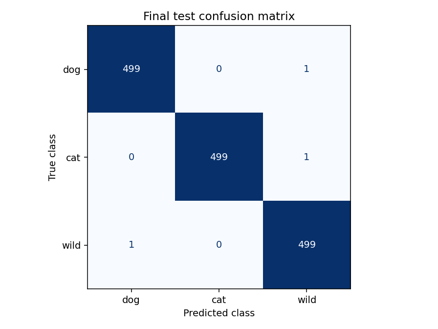
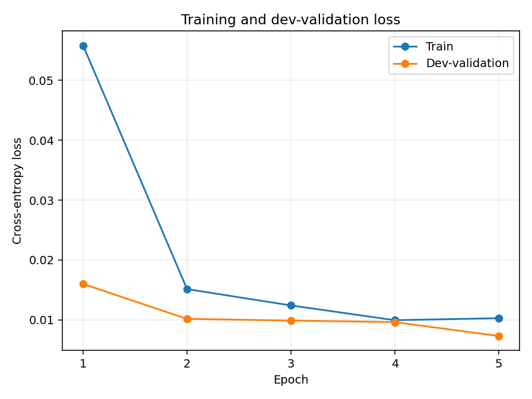
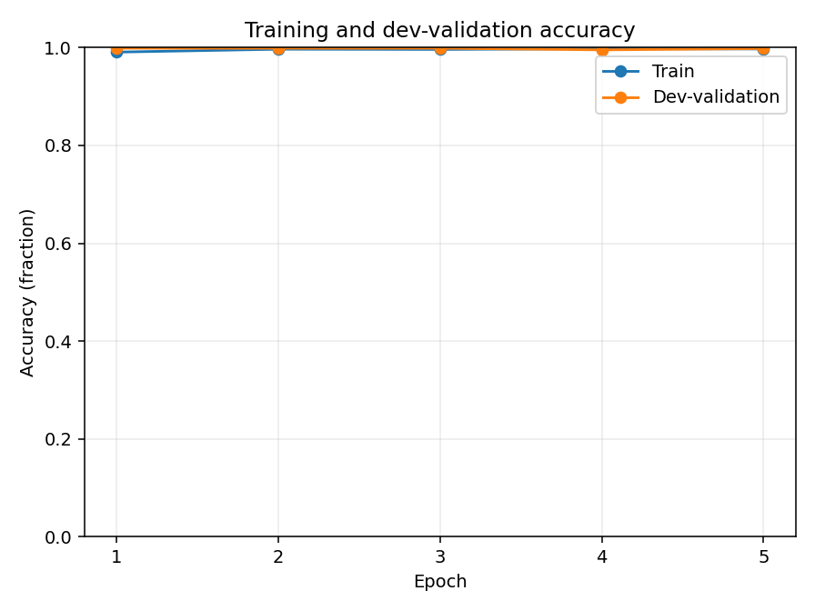
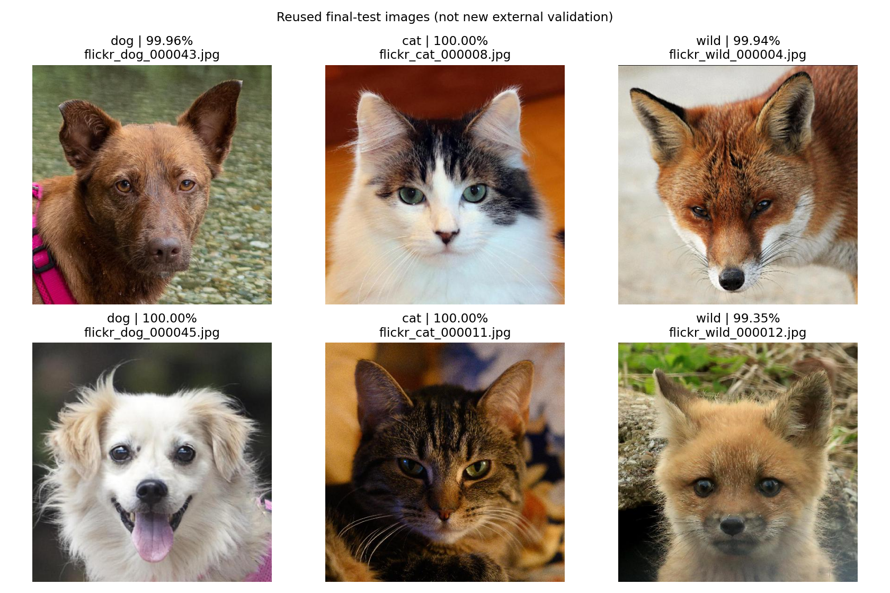

# Animal Image Classification with PyTorch

A reproducible image-classification pipeline for **dog, cat and wild** animal images. The model uses an ImageNet-pretrained ResNet18 as a frozen feature extractor and learns a three-class classification head.

The project includes data auditing, duplicate-aware splitting, augmentation, training, checkpoint selection, evaluation and fault-tolerant image prediction.

## Results

**Final test accuracy: 99.80% — 1,497 correct predictions out of 1,500 images.** The selected checkpoint is from epoch 5, chosen using the lowest development-validation loss.

| Class | Precision | Recall | F1-score | Test images |
| --- | ---: | ---: | ---: | ---: |
| Dog | 99.80% | 99.80% | 99.80% | 500 |
| Cat | 100.00% | 99.80% | 99.90% | 500 |
| Wild | 99.60% | 99.80% | 99.70% | 500 |
| Macro average | 99.80% | 99.80% | 99.80% | 1,500 |

Development-validation accuracy was **99.7949%**, closely matching the final test result. The test set was not used for model tuning or checkpoint selection.

### Confusion matrix

Rows show the true class and columns show the predicted class. Each cell contains the number of images.



### Training curves

Training and development-validation loss decreased overall across the five epochs.





### Prediction examples

The visual below shows six examples from the reserved test set. These examples demonstrate inference and are not an additional independent evaluation. Full top-three probabilities are available in [predictions.json](results/predictions.json).



The three test errors involve dog/wild visual similarity and one possible cat/wild label ambiguity. The original labels were retained. Detailed metrics and error observations are available in [test_metrics.json](results/test_metrics.json) and [error_review.json](results/error_review.json).

## Setup

Use Python 3.10 or newer; Python 3.12 or 3.13 is recommended.

```bash
python3 -m venv .venv
source .venv/bin/activate
python -m pip install --upgrade pip
python -m pip install -r requirements.txt
```

On Windows, activate the environment with `.venv\Scripts\Activate.ps1`.

Dependencies are pinned in `requirements.txt`: PyTorch 2.9.1, torchvision 0.24.1, NumPy 2.2.6, Pillow 12.0.0, scikit-learn 1.7.2, matplotlib 3.10.7 and pytest 8.4.2. For CUDA/ROCm installations, use the appropriate platform instructions from [PyTorch](https://pytorch.org/get-started/previous-versions/) with the same package versions.

## Trained model

The ready-to-use trained model is included at:

```text
checkpoints/best_model.pt
```

The checkpoint contains the full model state, selected epoch, validation loss, class names and configuration. Keep `history.csv` and `training_status.json` in the same directory; they verify that the selected epoch has the lowest development-validation loss.

| Model setting | Value |
| --- | --- |
| Backbone | ResNet18 with ImageNet initialization |
| Classifier | Linear(512, 3) |
| Trainable parameters | 1,539 of 11,178,051 |
| Input size | 224 × 224 RGB |
| Epochs | 5 |
| Optimizer | Adam, learning rate 0.001 |
| Batch size | 32 |
| Loss | CrossEntropyLoss |
| Selected epoch | 5 |
| Selected dev-validation loss | 0.00730585365807671 |

Only `fc.weight` and `fc.bias` are trainable. Frozen BatchNorm layers remain in evaluation mode during training so their running statistics are not updated. The portable checkpoint preserves all trained tensor values; its checksum is recorded in [model_manifest.json](results/model_manifest.json).

## Dataset

The supplied AFHQ images use this layout:

```text
afhq/
  train/
    dog/
    cat/
    wild/
  val/
    dog/
    cat/
    wild/
```

| Class | Training split | Dev-validation split | Final test split |
| --- | ---: | ---: | ---: |
| Dog | 4,264 | 475 | 500 |
| Cat | 4,636 | 517 | 500 |
| Wild | 4,267 | 471 | 500 |
| Total | 13,167 | 1,463 | 1,500 |

The original training pool is split 90%/10% using stratified content groups. Four byte-identical pairs were detected with SHA-1 and kept entirely within one split. There is no exact content-hash overlap across train, dev-validation and test. File hashing does not detect re-encoded or near-identical images.

The existing `val` folder is reserved for final testing. Train/dev assignments are saved in `artifacts/phase1/split_manifest.csv`. Raw dataset images and environment directories are excluded from this submission; place the supplied dataset in `afhq/` when reproducing evaluation.

## Usage

### Predict new images

```bash
python main.py predict --input-dir new_images
python main.py predict --images example.jpg another.png missing.jpg
```

Prediction returns the class, softmax confidence and top-three probabilities. Missing, non-image or corrupt files receive individual error records without stopping other inputs. Grayscale, RGBA and palette images are converted to RGB. Softmax confidence is not calibrated and does not identify unknown categories.

### Evaluate the included checkpoint

```bash
python main.py evaluate --data-root afhq
```

Evaluation restores the selected checkpoint and its saved preprocessing. It uses `model.eval()` and `torch.no_grad()` and does not update the model.

### Reproduce training

```bash
python main.py split --data-root afhq
python main.py transforms
python main.py model
python main.py train --epochs 5 --batch-size 32 --lr 0.001
python main.py evaluate
```

Training uses only train/dev loaders. Training augmentation consists of horizontal flips, rotations up to 10 degrees and brightness/contrast jitter of 0.2. Evaluation and prediction use deterministic resizing and ImageNet normalization.

The first training/model-construction run may download ImageNet initialization weights. Evaluation and prediction restore the included complete trained state and do not require that download.

Use `python main.py --help` for all options, including `--device`, `--checkpoint`, `--manifest`, `--data-root` and output-directory overrides. Device selection supports CUDA, MPS and CPU. All hyperparameters are centralized in `config.py`.

## Project structure

| Location | Purpose |
| --- | --- |
| `config.py` | Validated shared configuration |
| `cli.py`, `main.py` | Argument parsing and pipeline entry points |
| `data/` | Integrity audit, grouped splitting, transforms, datasets and loaders |
| `models/` | Model-builder interface, registry and frozen feature extractor |
| `training/` | Injected trainer, metrics, reporting and checkpoint strategies |
| `evaluation/` | Evaluator, pluggable metrics and checkpoint verification |
| `inference/` | Predictor, per-file error isolation and visual reporting |
| `checkpoints/` | Trained model and selection metadata |
| `results/` | Report figures, metrics and model checksum |
| `tests/` | Unit and integration tests |

The design separates responsibilities, uses small interfaces and accepts interchangeable implementations through dependency injection. Splitters and model/transform registries support alternative strategies without changing their callers. The Evaluator accepts injected metrics, while the Trainer accepts its optimizer, loss, loaders and checkpoint policy.

## Tests and reproducibility

```bash
python -m pytest -q
```

The suite covers duplicate leakage, split proportions, preprocessing, image modes, frozen parameters, BatchNorm state, checkpoint round trips, training/test isolation, metric extensions, inference failures and CLI routing.

**Verification: 107 tests passed** in the clean submission folder. The test result is saved in [test_results.log](results/test_results.log).

Seeds are set for Python, NumPy, torch and DataLoader generators. Training requests deterministic algorithms. Exact numerical equality across different devices or library versions is not guaranteed. The checkpoint does not include optimizer/RNG state for exact mid-run resumption.

## References and attribution

- He et al., [Deep Residual Learning for Image Recognition](https://arxiv.org/abs/1512.03385): ResNet architecture.
- [torchvision ResNet18](https://docs.pytorch.org/vision/stable/models/generated/torchvision.models.resnet18.html): ImageNet-pretrained implementation and weights.
- Choi et al., [StarGAN v2](https://openaccess.thecvf.com/content_CVPR_2020/html/Choi_StarGAN_v2_Diverse_Image_Synthesis_for_Multiple_Domains_CVPR_2020_paper.html) and the [official AFHQ release](https://github.com/clovaai/stargan-v2#animal-faces-hq-dataset-afhq): dataset source.
- [scikit-learn](https://scikit-learn.org/stable/modules/model_evaluation.html): classification metrics.

This project applies transfer learning using the credited pretrained architecture and dataset. The recorded results describe the supplied held-out dataset; independent external-image robustness has not been measured.
